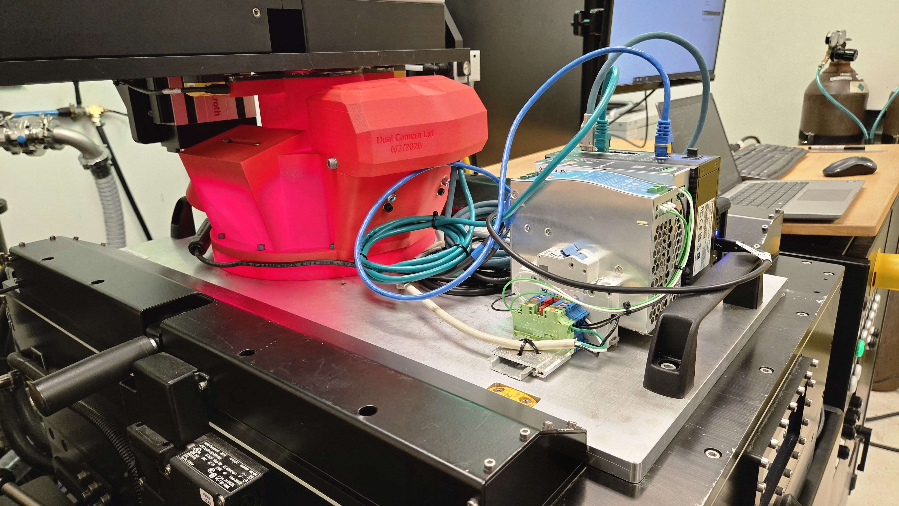
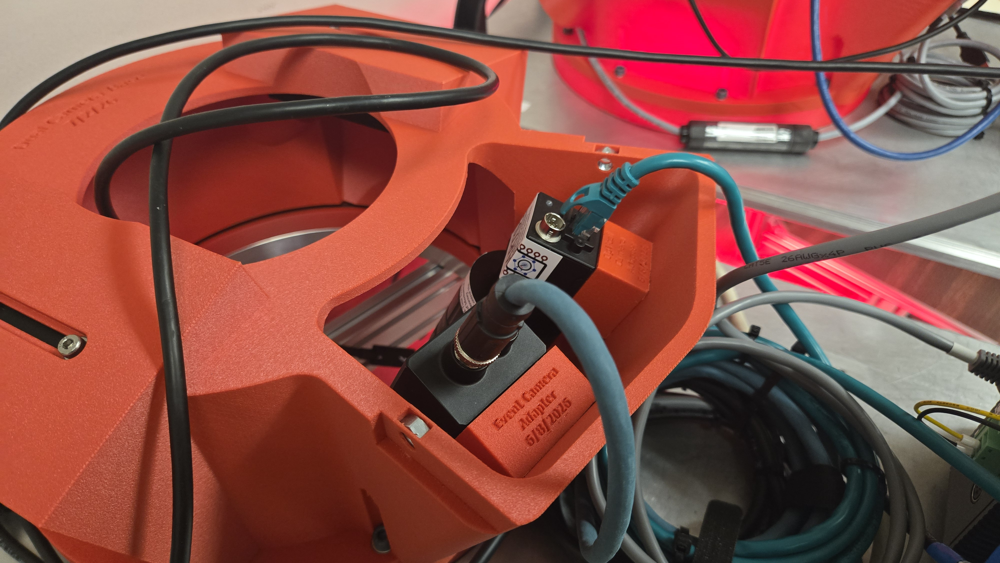

# V0.5.1
Adding distinct software controls for variations of the Damascus setup.

## Version of cover on LPBF Machine

   
Integrated dual vision holder securely mounts a event camera and an optical camera for both asychronous and synchronized data acquisition on a custom cover. 

## View of both cameras

   
Experimental setup showing both the event camera and optical camera 

