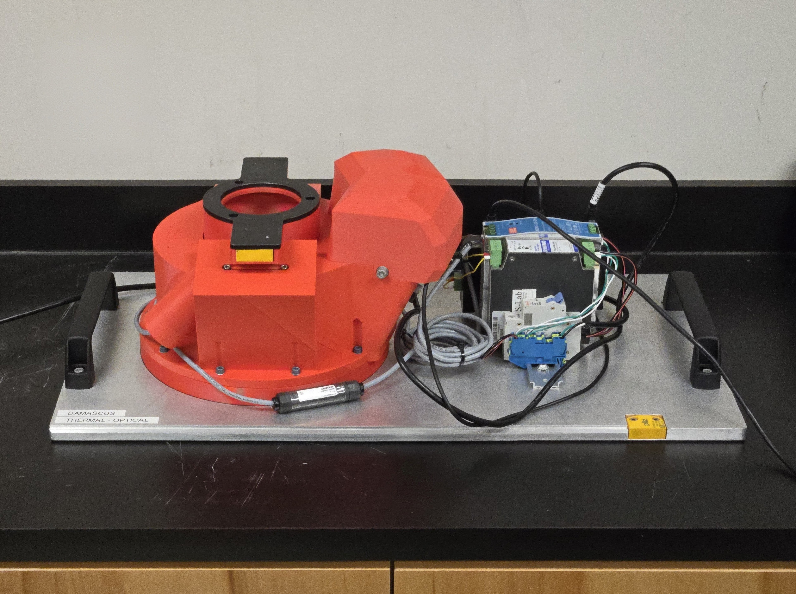

# Systems Variations  
Different system variations (i.e., product lines) are named after cities historically known for metalworking and steel production.  

## [Damascus](Damascus)
* Damascus, Syria — historically associated with high-quality patterned steel, known for its strength and distinctive appearance.
* Sensing system designed with multiple cameras.

   
Integrated dual vision holder securely mounts a thermal camera and an optical camera for synchronized data acquisition on a custom cover. 

## [Sheffield](Sheffield)
* Sheffield, England, United Kingdom — a world-renowned center for steel production, known for crucible and stainless steel innovations.
* Sensing system designed with a laser vibrometer.

   
Experimental setup including custom cover assembly, laser vibrometer, piezoelectric transducer, and pulser. 

